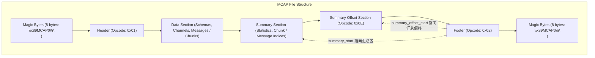
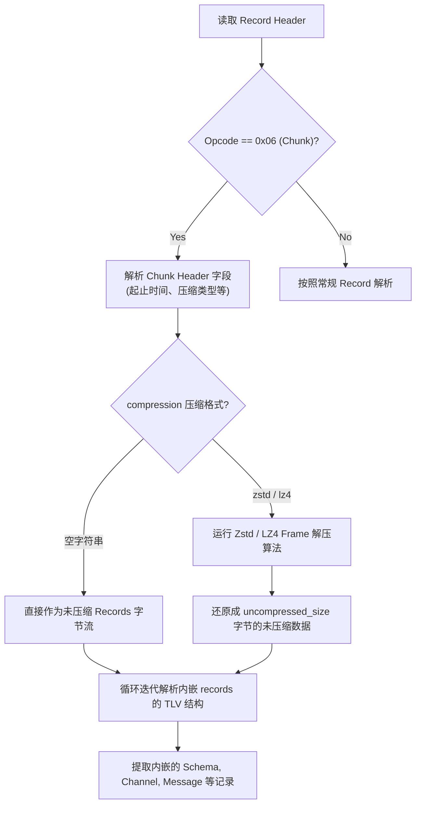

## 1. 基本定义

`MCAP` (Message Capture) 是一种用于记录机器人、自动驾驶等场景下结构化消息数据的日志容器格式。它由 Foxglove 团队设计并开源，具有以下特点：

- **自描述**：数据与消息定义打包在一起，脱离原生环境也能解析。
- **支持随机访问**：通过尾部索引可快速定位到任意时间点。
- **流式读写**：支持追加写入，写入过程崩溃时已落盘数据不会损坏。
- **高效压缩**：按数据块独立压缩，读取时仅解压需要的部分。
- **语言与框架中立**：不绑定 ROS，但已作为 ROS 2 的默认存储插件之一。

## 2. 核心概念

在 `MCAP` 文件中，数据的组织围绕以下概念展开：

- **Channel**：对应一个消息流，类似 ROS 中的 Topic。每个 `Channel` 拥有唯一 ID、名称、消息编码格式和引用的 `Schema`。
- **Schema**：描述消息的序列化格式，例如 ROS 2 `.msg`、`Protobuf`、`JSON Schema` 等。`Schema` 以名称和内容（二进制或文本）的形式存储在文件中。
- **Message**：一条具体的消息数据，包含所属 `Channel` ID、发布时间戳、以及序列化后的消息内容。
- **Chunk**：一个数据块，将一组 `Message` 打包在一起，并可对整个块进行压缩。`Chunk` 内部会记录包含的消息起止时间，用于快速过滤。

## 3. 文件物理结构

`MCAP` 文件采用严格的线性结构，前后对称的 Magic 字节包裹，物理层级结构图如下所示：



物理区域排布细化表如下：

```
+-----------------------------------------------------------+
| Magic Bytes (文件开始标识，8 字节: \x89MCAP0\r\n)          |
+-----------------------------------------------------------+
| Header Record (头部信息，Opcode: 0x01)                     |
+-----------------------------------------------------------+
|                                                           |
| Data Section (数据区，包含若干 Record / Chunk)             |
| - Schema Records (结构描述，Opcode: 0x03)                  |
| - Channel Records (通道/话题关联，Opcode: 0x04)            |
| - Message / Chunk Records (消息内容，Opcode: 0x05 / 0x06)  |
|                                                           |
+-----------------------------------------------------------+
| Summary Section (汇总区，全局索引信息)                     |
| - Statistics Record (统计数据，Opcode: 0x0B)               |
| - Chunk Index Records (分块索引，Opcode: 0x08)             |
| - Message Index Records (消息索引，Opcode: 0x07)           |
| - Metadata / Metadata Index Records                       |
+-----------------------------------------------------------+
| Summary Offset Section (汇总偏移区，Opcode: 0x0E)          |
+-----------------------------------------------------------+
| Footer Record (尾部记录，Opcode: 0x02)                     |
+-----------------------------------------------------------+
| Magic Bytes (文件结束标识，8 字节: \x89MCAP0\r\n)          |
+-----------------------------------------------------------+
```

各部分说明：

- **Magic**：固定值，文件头尾各 8 字节，二进制内容为 `0x89`、`M`、`C`、`A`、`P`、`0`、`\r`、`\n`（即 `\x89MCAP0\r\n`）。用于快速识别文件格式并避免被误识别为纯文本，尾部 Magic 可用于判断文件完整性。
- **Header**：记录文件元信息，包括 `profile`（所遵循的规范子集，如 `ros2`）和 `library`（写文件的库信息）。Header 以 Record 形式存储，opcode 为 `0x01`。
- **Data Section**：主体数据区域，由顺序写入 of Record 组成。关键 Record 类型包括 `Channel` 定义、`Chunk` 和独立 `Message`。写入时可流式追加，没有固定大小限制。
- **Summary Section**：全量索引区域，通常在所有数据写完并关闭文件时生成。包含：
  - Channel 汇总信息（所有 Channel 的 ID、名称、Schema 引用）
  - Chunk Index：每个 Chunk 的文件起始偏移、长度、压缩信息及起止时间
  - Message Index：消息级索引，按 Channel 分组，每个条目指向某个 Chunk 内的时间与偏移
  - Statistics：统计信息，如消息总数、Channel 总数等
  - Attachment / Metadata 索引等
- **Summary Offset**：存放 Summary Section 各类型记录的物理偏移及长度，opcode 为 `0x0E`。

## 4. 记录类型 (Opcode)

`MCAP` 文件由一系列 Record 按顺序拼接而成。每条 Record 拥有统一的头部：

| 字段 | 类型 | 说明 |
| ------ | -------------- | ---------------------- |
| opcode | 1 字节 | 记录类型标识 |
| length | 8 字节 | 后续 data 部分的字节数 |
| data | 变长二进制数据 | 具体负载 |

常见 opcode 及其用途如下：

| Opcode | 名称 | 说明 |
| ------ | ---------------- | --------------------------------------- |
| `0x01` | Header | 文件头，包含 profile 和 library |
| `0x02` | Footer | 文件尾，记录 Summary 区的起始偏移 |
| `0x03` | Schema | 存放数据结构定义文本（如 `.msg`、`.proto`） |
| `0x04` | Channel | 描述话题名称、编码格式、引用的 Schema |
| `0x05` | Message | 消息数据，含时间戳和序列化负载 |
| `0x06` | Chunk | 将一批 Message 打包并压缩 |
| `0x07` | Message Index | 在 Summary 中，消息级索引 |
| `0x08` | Chunk Index | 在 Summary 中，Chunk 级索引 |
| `0x09` | Attachment | 附件数据 |
| `0x0A` | Attachment Index | 在 Summary 中，附件的索引 |
| `0x0B` | Statistics | 统计信息（消息总数、起止时间等） |
| `0x0C` | Metadata | 用户自定义键值对元数据 |
| `0x0D` | Metadata Index | 在 Summary 中，元数据的索引 |
| `0x0E` | Summary Offset | 指向 Summary 各细分区域的指针 |

理解这些 Record 的序列化格式有助于手动解析或编写读写工具。以 Channel Record (`0x04`) 为例，其 data 部分包含：

- `id` (2 bytes)
- `schema_id` (2 bytes)
- `topic` (string)
- `message_encoding` (string) ← 决定了消息体的序列化方式
- `metadata` (map_str_str) 等

## 5. 支持的数据序列化格式

`MCAP` 本身不限定消息体必须使用某种特定的序列化方案，而是通过 `Channel` 定义中的 `message_encoding` 字段 来声明每条消息的编码方式。配合 Schema 的内容，任何能产生字节串的序列化格式都可以被封装。

`message_encoding` 是一个字符串，由写入端指定。常用的编码字符串及其含义如下：

| encoding 字符串 | 含义 | 典型 Schema 内容 |
| ------------------ | ------------------------------------------------------- | ------------------------------------- |
| `ros1msg` | ROS 1 消息序列化（基于 TCPROS 格式） | ROS 1 `.msg` 文件文本 |
| `ros2msg` 或 `cdr` | ROS 2 消息序列化，使用 CDR (Common Data Representation) | ROS 2 `.msg` 文件文本（或 ROS 2 IDL） |
| `protobuf` | Protocol Buffers 序列化 | 二进制 `FileDescriptorSet` |
| `flatbuffers` | FlatBuffers 序列化 | 二进制 FlatBuffers Schema |
| `json` | JSON 文本编码 | JSON Schema（可选） |

## 6. 压缩机制

压缩仅作用于 `Chunk` 级别，一个 `Chunk` 可包含多条 `Message`。这种设计的好处是：

- 不破坏文件整体自描述性，索引依然可直接读取。
- 只解压被访问到的 `Chunk`，无需解压整个文件。

支持的压缩算法由 `Chunk` Header 中的 `compression` 字段指定：

- `""` (空字符串) — 不压缩
- `"zstd"` — Zstandard
- `"lz4"` — LZ4

`Chunk` 解析处理流程图如下：



`Chunk` 的物理组成结构如下：

1. **Chunk Record 头部** (opcode `0x06`)，其 body 包含：
   - `message_start_time` (8 bytes) — 该 Chunk 内消息的最早时间
   - `message_end_time` (8 bytes) — 该 Chunk 内消息的最晚时间
   - `uncompressed_size` (8 bytes) — 解压后的字节大小
   - `uncompressed_crc32` (4 bytes) — 解压后数据的 CRC-32 校验
   - `compression` (prefixed_str) — 压缩算法名（如 `"zstd"`, `"lz4"` 或空字符串 `""`）
   - `len_records` (8 bytes) — records 部分的长度
2. 紧接着是压缩或未压缩的 `records` 数据块。
3. 解压该数据块后，得到一系列连续的 MCAP 记录，通常包括 `Schema`、`Channel` 和 `Message` 记录（Message 的 opcode 为 `0x05`）。

在 Summary Section 的 Chunk Index 中，每个 `Chunk` 会记录其文件偏移、压缩前后长度、起止时间等，因此解析器可以轻松定位并解压指定 `Chunk`。

## 7. 索引与随机访问流程

`MCAP` 高效随机访问的核心在于“尾部摘要”。标准读取流程如下：

1. 打开文件，校验尾部 Magic。
2. 从文件末尾倒数固定偏移处读取 **Footer Record** (opcode `0x02`)，从而直接获取 `summary_start`（Summary Section 的起始位置）以及 `summary_offset_start`（Summary Offset Section 的起始位置）。
3. 跳转到 Summary Section 对应的位置，顺序解析其内部的 Record，构建内存索引：
   - Channel 汇总信息：解析所有的 Schema 和 Channel。
   - Chunk Index：记录每个 Chunk 的文件区间、时间范围等。
   - Message Index（可选）：消息级精确定位，包含每个消息所在的时间戳与偏移量。
4. 当请求“读取 Channel `/imu` 在时间 10.0s 之后的消息”时：
   - 根据 Chunk Index 或 Message Index 找到包含该时间点的 `Chunk`。
   - 获取该 `Chunk` 的文件偏移和压缩信息。
   - 读取并解压该 `Chunk` 的数据部分。
   - 遍历内部 `Message` Record，过滤出目标 Channel 和时间戳的消息。

因为索引集中在文件尾部，该格式天然适合通过 HTTP Range 请求远程读取。客户端只需先请求尾部字节获取 Summary，再按需请求对应 `Chunk` 的字节范围，即可在不下载完整文件的情况下实现回放。

## 8. 常用工具与实操

直接参考官方指南：[mcap.dev/guides](https://mcap.dev/guides)
